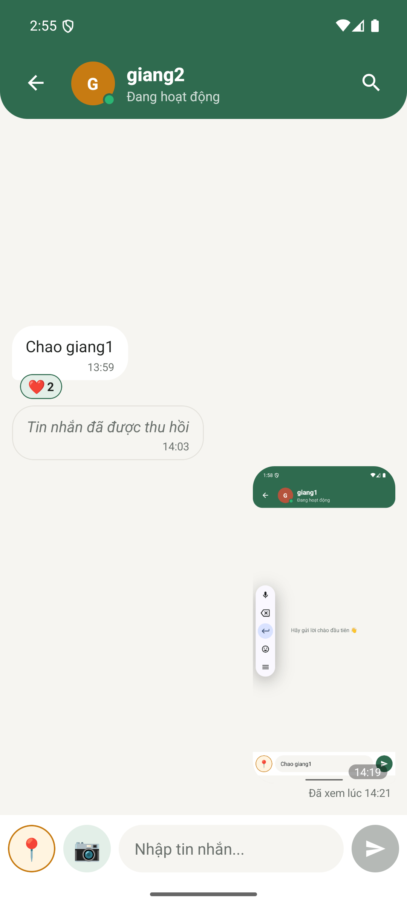
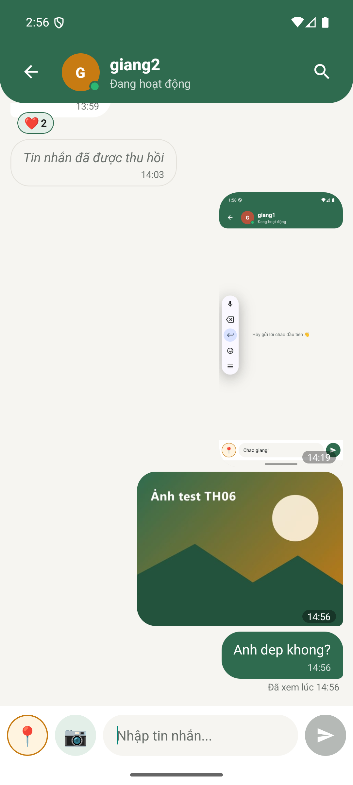
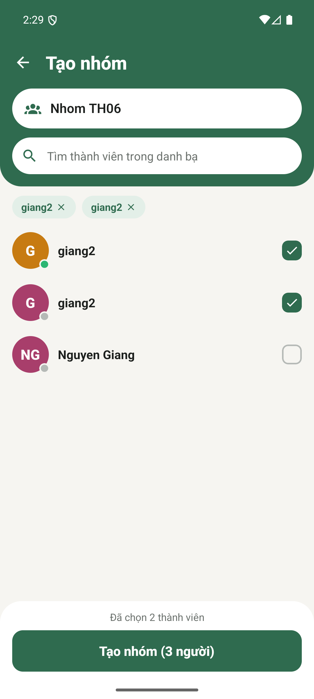
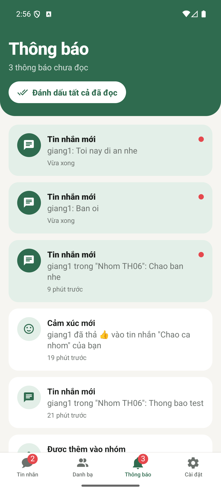
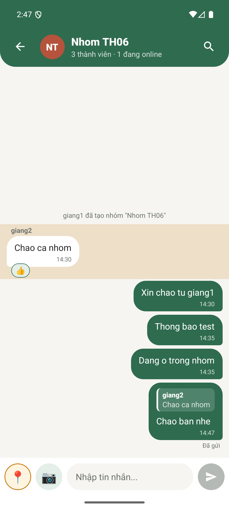
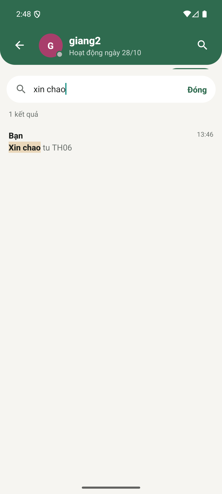
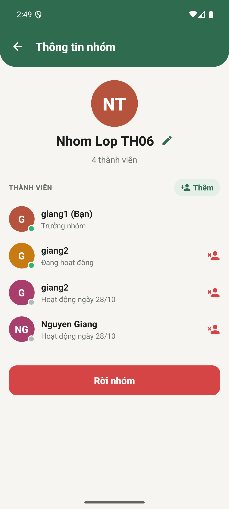
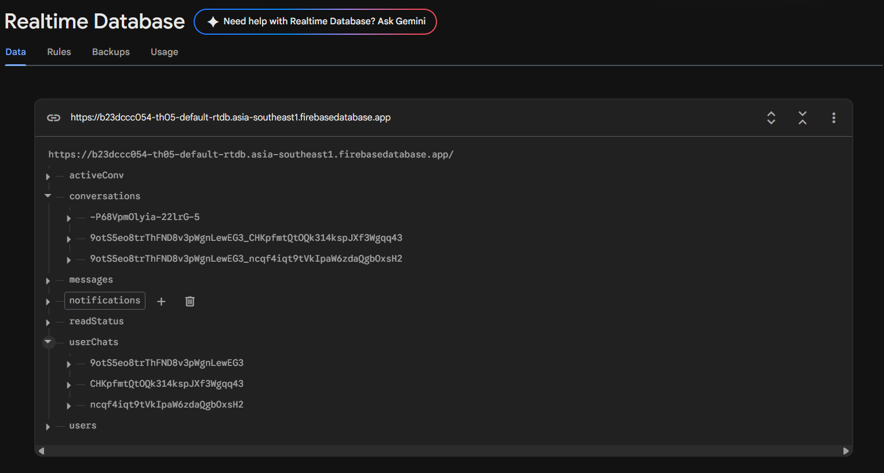
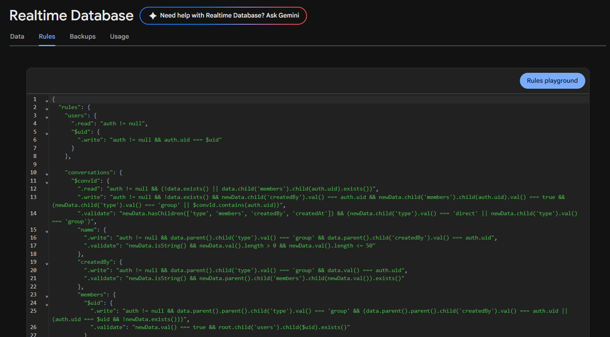

# Trò Chuyện: Chat realtime nâng cao (Bài thực hành 6)

Môn Lập trình ứng dụng cho thiết bị di động. Sinh viên: **B23DCCC054**

Đây là bản phát triển tiếp ứng dụng chat của Bài thực hành 5 (React Native CLI + Firebase). Bài 6 bổ sung chat nhóm, gửi ảnh qua Cloudinary, trạng thái "đang soạn tin…" và "Đã xem", thu hồi tin, thả cảm xúc và màn Thông báo dùng dữ liệu thật. Phần nâng cao gồm trả lời tin, tìm kiếm tin và quản trị nhóm.

---

## Ảnh chụp màn hình

| Đang soạn tin… và Đã xem | Thu hồi và cảm xúc | Tin ảnh |
|:---:|:---:|:---:|
|  |  |  |

| Tạo nhóm | Chat nhóm có tên người gửi | Thông báo có badge |
|:---:|:---:|:---:|
|  |  |  |

| Trả lời tin | Tìm kiếm tin | Quản trị nhóm |
|:---:|:---:|:---:|
|  |  |  |

| Firebase Console: Data | Firebase Console: Rules |
|:---:|:---:|
|  |  |

## Hồ sơ nộp bài

| Sản phẩm | Vị trí |
|---|---|
| Video demo 3 máy ảo (khoảng 3 phút, có chú thích từng bước) | [docs/video/demo_3_may.mp4](docs/video/demo_3_may.mp4) |
| Báo cáo luật bảo mật 1 trang, có bằng chứng PERMISSION_DENIED | [PDF](docs/bao-cao/BaoCao_SecurityRules_B23DCCC054.pdf) · [DOCX](docs/bao-cao/BaoCao_SecurityRules_B23DCCC054.docx) |
| Luật bảo mật | [database.rules.json](database.rules.json) |
| Script kiểm thử luật và kết quả (20/20) | [scripts/test-rules.mjs](scripts/test-rules.mjs) · [docs/rules-test-output.txt](docs/rules-test-output.txt) |
| Ảnh chụp màn hình | [docs/screenshots](docs/screenshots) |

---

## Chức năng

### Phần A: bắt buộc

**1. Trạng thái trong cuộc trò chuyện**
- Khi người kia đang gõ, tiêu đề hiện *"đang soạn tin…"*. Trong nhóm thì hiện *"An, Bình đang soạn tin…"*.
- Trạng thái đang gõ tự tắt sau 3 giây không gõ, khi gửi tin, khi rời màn hoặc khi app chuyển xuống nền.
- Dưới tin mới nhất của mình hiện **"Đã gửi"** hoặc **"Đã xem lúc HH:mm"**, cập nhật realtime. Trong nhóm thì hiện "Đã xem bởi N người".
- Khi người kia offline, tiêu đề hiện **"Hoạt động X phút trước"** (hoặc giờ trước, ngày trước) và tự cập nhật mỗi 30 giây.
- `typing`, `online/lastSeen` và `activeConv` đều đăng ký `onDisconnect()`, nên tắt app đột ngột cũng không bị kẹt trạng thái.

**2. Thu hồi và tương tác với tin nhắn**
- Nhấn giữ một tin để mở menu: 👍 ❤️ 😂 😮 😢, **Trả lời**, **Sao chép**, và **Thu hồi** (chỉ có ở tin của mình).
- Thu hồi không xóa node mà ghi `recalled: true` và xóa nội dung. Mọi máy đều thấy *"Tin nhắn đã được thu hồi"*. Nếu đó là tin cuối, dòng tin cuối ở Home của mọi thành viên cũng đổi theo, trong cùng một lệnh update.
- Cảm xúc hiện dưới bong bóng, có số lượng khi nhiều người cùng thả. Thả lại đúng emoji đang chọn sẽ gỡ cảm xúc đó.

**3. Gửi ảnh**
- Nút 📷 cho chọn *Chụp ảnh* hoặc *Thư viện* (`react-native-image-picker`). App xin quyền camera; nếu bị từ chối thì báo cho người dùng.
- Ảnh được thu nhỏ để **cạnh dài ≤ 1024px** (`maxWidth/maxHeight`), rồi tải lên **Cloudinary** bằng *unsigned upload preset*. Realtime Database chỉ lưu URL ảnh, kèm kích thước để giữ đúng tỉ lệ.
- Trong lúc tải lên có bong bóng tạm với vòng loading và phần trăm. Tải lỗi thì có nút **Thử lại** và nút bỏ ảnh.
- Nhấn vào ảnh để xem toàn màn hình. Ở Home, tin cuối là ảnh thì hiện "📷 Hình ảnh", tin cuối là vị trí thì hiện "📍 Vị trí".

**4. Chat nhóm**
- Màn **Tạo nhóm** có ô tên nhóm, ô tìm kiếm và danh bạ có checkbox. Phải chọn **tối thiểu 2 người** ngoài bản thân.
- Trong nhóm, tin của người khác có tên người gửi phía trên bong bóng. Tiêu đề hiện "Tên nhóm · N thành viên · M đang online".
- Home hiện cả chat 1-1 lẫn nhóm, sắp theo tin mới nhất. Mỗi thành viên có số tin chưa đọc riêng.
- Nhóm hỗ trợ đủ tin thường, tin vị trí và tin ảnh.

**5. Màn Thông báo dùng dữ liệu thật** (`notifications/{uid}`)
- Thông báo được ghi khi có tin mới mà người nhận **không** đang mở cuộc trò chuyện đó (dựa vào `activeConv/{uid}`), khi được thêm vào nhóm, và khi có người thả cảm xúc vào tin của mình.
- Tab Thông báo có badge số chưa đọc. Nhấn vào thông báo thì mở đúng cuộc trò chuyện và đánh dấu đã đọc. Có nút **"Đánh dấu tất cả đã đọc"**.

### Phần B: yêu cầu kỹ thuật
- Tin nhắn, `lastMessage` và số chưa đọc của mọi thành viên (cùng thông báo) được ghi trong **một lệnh `update()` nhiều đường dẫn**. Số chưa đọc tăng bằng `increment(1)`.
- **Tải theo trang:** lần đầu `limitToLast(20)`, kéo lên thì `endBefore(oldestKey).limitToLast(20)`. Danh sách là FlatList `inverted` nên tin cũ được nối vào cuối mảng, danh sách không bị nhảy.
- Code Firebase và Cloudinary nằm trong `src/services/`. Mọi listener được hủy trong cleanup của `useEffect`.
- **Không có API secret** của Cloudinary trong mã nguồn, chỉ dùng unsigned preset.
- Security Rules tự viết: xem [`database.rules.json`](database.rules.json) và mục [Luật bảo mật](#luật-bảo-mật).

### Phần C: nâng cao
- **Trả lời một tin (reply/quote):** nhấn vào phần trích dẫn thì cuộn tới tin gốc và tô sáng nó. Nếu tin gốc chưa được tải, app tải thêm đoạn tin cũ trong một truy vấn rồi cuộn tới.
- **Tìm kiếm nội dung tin nhắn** trong một cuộc trò chuyện: không phân biệt dấu ("chao" tìm ra "chào"), tô đậm đoạn khớp, nhấn vào kết quả thì nhảy tới tin.
- **Quản trị nhóm:** trưởng nhóm đổi tên nhóm, thêm và xóa thành viên. Ai cũng rời nhóm được, kèm tin hệ thống *"A đã rời nhóm"*. Trưởng nhóm rời đi thì quyền được chuyển cho người khác.

---

## Công nghệ

| | |
|---|---|
| Nền tảng | React Native CLI 0.88 (New Architecture), TypeScript |
| Backend | Firebase JS SDK 13: Authentication (Email/Password) và Realtime Database |
| Lưu ảnh | Cloudinary (unsigned upload preset, gọi REST bằng `XMLHttpRequest`) |
| Thư viện | `@react-navigation/*`, `react-native-image-picker`, `@react-native-clipboard/clipboard`, `@react-native-community/geolocation`, `react-native-vector-icons`, `@react-native-async-storage/async-storage` |
| Kiểm thử | Jest (79 test cho service, hook và tiện ích) và kiểm thử luật bảo mật trên Firebase Emulator |

## Cấu trúc thư mục

```
src/
├── services/              # toàn bộ code Firebase và Cloudinary
│   ├── firebase.ts            # khởi tạo app, auth (giữ phiên), database
│   ├── firebaseConfig.ts      # cấu hình web app Firebase
│   ├── cloudinaryConfig.ts    # cloud name và unsigned preset (KHÔNG có secret)
│   ├── chatService.ts         # gửi tin (multi-path), phân trang, thu hồi, cảm xúc, tìm kiếm
│   ├── groupService.ts        # tạo nhóm, đổi tên, thêm/xóa thành viên, rời nhóm
│   ├── uploadService.ts       # chọn/chụp ảnh, xin quyền camera, tải lên Cloudinary
│   ├── notificationService.ts # ghi, nghe, đánh dấu đã đọc thông báo
│   ├── presenceService.ts     # đang soạn tin, đã xem, cuộc trò chuyện đang mở
│   ├── userService.ts         # danh bạ, online/offline, lastSeen
│   ├── authService.ts         # đăng ký, đăng nhập, đăng xuất
│   └── locationService.ts     # quyền và lấy vị trí
├── hooks/                 # useMessages (phân trang), useTyping, useNow
├── context/               # AuthContext, ChatsContext (userChats, conversations, notifications)
├── screens/               # Home, Danh bạ, Chat, Tạo nhóm, Thông tin nhóm, Thông báo, ...
├── components/            # MessageBubble, MessageActions, ImageBubbles, SearchPanel, ...
└── navigation/
database.rules.json        # luật bảo mật Realtime Database
scripts/test-rules.mjs     # kiểm thử luật bảo mật trên Firebase Emulator
```

## Cấu trúc dữ liệu (Realtime Database)

```
conversations/{convId}      { type: "direct" | "group", name, members: {uid: true}, createdBy, createdAt }
messages/{convId}/{msgId}   { senderId, type: "text"|"image"|"location"|"system", text, imageUrl, width, height,
                              lat, lng, createdAt, recalled, reactions: {uid: "❤️"}, replyTo: {id, senderId, preview} }
userChats/{uid}/{convId}    { lastMessage, lastSenderId, lastMsgId, updatedAt, unread }
readStatus/{convId}/{uid}   thời điểm đọc cuối
typing/{convId}/{uid}       true
activeConv/{uid}            convId đang mở (để quyết định có ghi thông báo hay không)
notifications/{uid}/{id}    { type: "message"|"group_added"|"reaction", convId, fromUid, text, createdAt, read }
users/{uid}                 { name, email, online, lastSeen }
```

- Chat 1-1 dùng `convId = uidA_uidB` (sắp xếp uid), được tạo bằng transaction khi gửi tin đầu tiên.
- Chat nhóm dùng `push()` id.

---

## Cài đặt và chạy

### 1. Cấu hình Firebase

1. Vào [Firebase Console](https://console.firebase.google.com), tạo project rồi thêm một **Web app**. Copy cấu hình vào [`src/services/firebaseConfig.ts`](src/services/firebaseConfig.ts).
2. **Authentication → Sign-in method:** bật **Email/Password**.
3. **Realtime Database:** tạo database (ví dụ vùng `asia-southeast1`). Sao chép đúng `databaseURL` vào `firebaseConfig.ts`.
4. **Đưa luật bảo mật lên**, chọn một trong hai cách:
   - Console: Realtime Database → **Rules**, dán nội dung [`database.rules.json`](database.rules.json) rồi bấm **Publish**.
   - CLI:
     ```bash
     npm install -g firebase-tools
     firebase login
     firebase deploy --only database --project <project-id>
     ```
     `firebase.json` trỏ sẵn tới `database.rules.json`. Đổi project mặc định trong `.firebaserc`.

### 2. Cấu hình Cloudinary (chỉ dùng unsigned preset)

1. Tạo tài khoản ở [cloudinary.com](https://cloudinary.com). Lấy **cloud name** ở Dashboard.
2. **Settings → Upload → Upload presets → Add upload preset:** chọn **Signing mode: Unsigned**, đặt *Folder* (ví dụ `chat-th06`) rồi lưu. Cũng có thể tạo bằng CLI:
   ```bash
   cld admin create_upload_preset name=chat_th06 unsigned=true folder=chat-th06
   ```
3. Điền vào [`src/services/cloudinaryConfig.ts`](src/services/cloudinaryConfig.ts):
   ```ts
   export const cloudinaryConfig = { cloudName: '<cloud name>', uploadPreset: '<tên preset unsigned>' };
   ```
   **Không** đưa API key hay API secret vào mã nguồn. Unsigned preset chỉ cần cloud name và tên preset.

### 3. Chạy app (Android)

Yêu cầu: Node ≥ 22.11, JDK 17+, Android SDK và một máy ảo hoặc điện thoại.

```bash
npm install
npm start            # Metro
npm run android      # build và cài app
```

Ảnh trong bong bóng chat được thu nhỏ thêm qua URL biến đổi của Cloudinary (`c_limit,w_600,q_auto`).

### 4. Kiểm thử

```bash
npm test                                   # 79 test Jest (không cần mạng)
npx tsc --noEmit && npx eslint src __tests__
firebase emulators:exec --only database --project demo-th06 "node scripts/test-rules.mjs"   # kiểm thử luật bảo mật
```

---

## Luật bảo mật

Xem đầy đủ trong [`database.rules.json`](database.rules.json). Tóm tắt:

| Dữ liệu | Đọc | Ghi |
|---|---|---|
| `conversations/{id}` | Thành viên | Tạo mới: người tạo phải có trong `members`. Đổi tên, thêm/xóa thành viên: **chỉ trưởng nhóm**. Thành viên chỉ được tự xóa mình (rời nhóm) |
| `messages/{convId}` | **Chỉ thành viên** | Tạo tin: thành viên, đúng `senderId = auth.uid`, không ghi đè tin cũ. `recalled`: **chỉ người gửi**. `reactions/{uid}`: **chỉ chính mình** |
| `typing/{convId}/{uid}` | Thành viên | **Chỉ chính mình** |
| `readStatus/{convId}/{uid}` | Thành viên | Chỉ chính mình |
| `userChats/{uid}` | Chính mình | Chính mình, hoặc thành viên cùng cuộc trò chuyện (cập nhật tin cuối và số chưa đọc) |
| `notifications/{uid}` | Chính mình | Người khác chỉ được **tạo mới** với `fromUid = auth.uid`. Chủ sở hữu được đánh dấu đã đọc |
